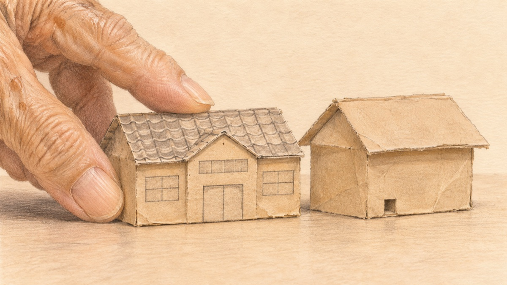

　登志さんの膝に、綿が一筋落ちていた。払おうとかがんだとき、その手にもう一軒の家があるのに気づいた。下の方に、同じような穴が開いている。

　登志さんは手にした家の窓から小指を、パン屋の方へ伸ばした。私は茶色い紙のパンを一つ、店の窓から差し出した。登志さんの指と私の指との間に、ちょうど一個、丸いのが挟まった。

「ここだったんですね。冬馬君がパンをくれたのは」

　登志さんがうなずいた。図書室でこの場面を読むたびに、冬馬君が路地越しにパンを渡すところを思い描いた。その路地が今、目の前にある。二軒の紙の家の間の、指一本分の隙間だ。

　パン屋を机に下ろすと、向かいの家の屋根が外れた。底には布の切れ端が敷いてある。掛け布団のつもりらしい。外れた屋根の裏に鉛筆の字があった。

〈ひっこしたら　とうまのとなり〉

　郵便局の底の綿をよけると、〈ひっこしたら　みんなのうちに　てがみをくばる〉と読めた。

　私は壁に貼った自分の地図を見た。学校の横がパン屋で、パン屋の横が登志さんの家だ。学校帰りの子が峠を越えなくていい。寝ている子だって買い物ができる。

「これ、杉森を覚えておくために作ったんじゃない。みんなで次に住む村を作ったんだ」

「学校を作った子に、私の家の隣に置いてって頼んだの。そしたら運動会の日、布団の中からでも、びりの子がゴールするまで見ていられるでしょう」

　登志さんは机の上で、厚紙の学校を自分の家の隣に置いた。私が本の通りに描いた絵地図でも、学校は登志さんの家の隣にある。香苗さんに、本当はお墓だと教えられた所だ。本に書いてあったのは、この机の上の家並みだった。

「私の部屋のね、枕元に机があって、そこに箱で作った家を並べたの。見舞いに来た子がそれぞれ自分の家の後ろに座って、窓から指を出すのよ。冬馬ちゃんは店の窓から指を出して、ちょいちょいって私を呼ぶの。私が手を伸ばすと、紙のパンを一つくれたわ。引っ越したら、今度こそ本物のパン屋でみんなに会いたかったわ」

　古い地図には、家ごとに違う行き先が書いてある。冬馬君も登志さんも、別々の町へ引っ越した。お菓子の箱の中では、二人の家はまだ隣同士だ。

「でも本には、大人になってから、ご自分で『ここにあった』と書いたんですね」

「ええ。原稿の初めには、私の机の上の村だって書いてあった。でも、初めにそう書いたら、冬馬ちゃんがパンをくれた日まで、ただの作り話だと思われそうで。あそこを削ったのは私よ。冬馬ちゃんのお店まで勝手に私の思い出にして、今日だって、裏に載せる絵が机の上の村だってことは、言わずに済ませようとしてたのね」

　私は壁から絵地図を外した。この絵は裏に載せよう。パン屋の下には、切り落とすつもりだった白い余白がある。私はそこを指で示した。

「この絵、私も手放したくありません。初めの二行を、ここに書いてくれますか」

　登志さんに鉛筆を渡した。登志さんは私が描いたパン屋の窓の下で一度手を止めて、それから、家の中の子にも読めるような、大きな字で書いた。

〈わたしの布団の横に、小さな村がありました。わたしたちは、そこへ引っ越すつもりでした。〉
